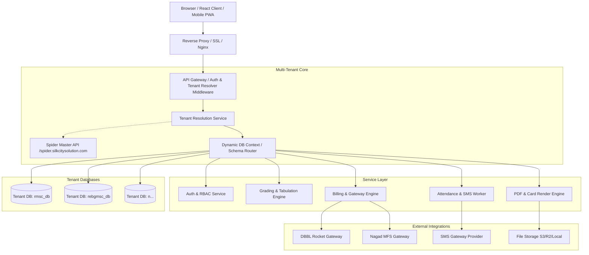
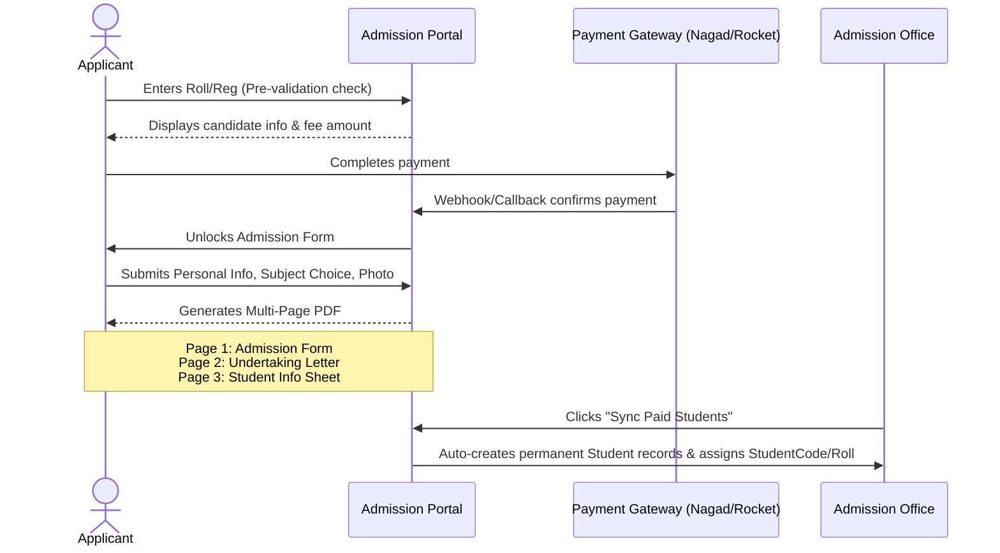

# SCSchooling - Full Project Features & Technical Blueprint for React/JS Rebuild

> **Target Audience:** Full-stack JavaScript / TypeScript Engineers, Architects, and React Developers.  
> **Source Platform:** SCSchooling Multi-Tenant School Management ERP (ASP.NET Core 8.0, SQL Server 2012, Entity Framework Core).  
> **Objective:** Comprehensive feature specification, domain logic, data models, calculation engines, APIs, and UI blueprint for rebuilding the platform using modern React and Node.js/TypeScript.

---

## Table of Contents
1. [Executive Summary & System Architecture](#1-executive-summary--system-architecture)
2. [Multi-Tenancy Model & Domain Routing](#2-multi-tenancy-model--domain-routing)
3. [Authentication, Authorization & Role-Based Access Control (RBAC)](#3-authentication-authorization--role-based-access-control-rbac)
4. [Complete Entity Data Models & Database Schema](#4-complete-entity-data-models--database-schema)
5. [Core Academic Structure](#5-core-academic-structure)
6. [Student Information System (SIS) & Lifecycle](#6-student-information-system-sis--lifecycle)
7. [Teacher & Staff Management](#7-teacher--staff-management)
8. [Examination, Grading & Tabulation Engine](#8-examination-grading--tabulation-engine)
9. [Digital Attendance & SMS Alert System](#9-digital-attendance--sms-alert-system)
10. [Admission & Online Enrollment Engine](#10-admission--online-enrollment-engine)
11. [Fee Collection, Billing & Payment Gateway Integration](#11-fee-collection-billing--payment-gateway-integration)
12. [ID Cards, Admit Cards & Document Generation](#12-id-cards-admit-cards--document-generation)
13. [Testimonials & Transfer Certificates (TC)](#13-testimonials--transfer-certificates-tc)
14. [Library & Leave Management Systems](#14-library--leave-management-systems)
15. [Bulk Messaging & SMS Gateway](#15-bulk-messaging--sms-gateway)
16. [Teacher & Student Portals (Self-Service)](#16-teacher--student-portals-self-service)
17. [System Administration, Settings, Import/Export & Audit](#17-system-administration-settings-importexport--audit)
18. [API Specifications & Gateway Contracts](#18-api-specifications--gateway-contracts)
19. [Recommended React / Modern JS Tech Stack & Rebuild Blueprint](#19-recommended-react--modern-js-tech-stack--rebuild-blueprint)
20. [Implementation Roadmap & Milestones](#20-implementation-roadmap--milestones)

---

## 1. Executive Summary & System Architecture

### 1.1 Overview
SCSchooling is an enterprise-grade multi-tenant School Management System and Educational ERP tailored for secondary, higher secondary, and degree colleges in Bangladesh. It handles complex academic rules (Bangla/English combined 200-mark subjects, 4th optional subject GPA offsets, continuous assessment, connected half-yearly/annual exam weightings), automated billing with MFS gateways (DBBL Rocket, Nagad), online admissions with multi-page printables, biometric and manual attendance with SMS alerts, and certificate generation.

### 1.2 High-Level Architecture Diagram



---

## 2. Multi-Tenancy Model & Domain Routing

The system uses a **Database-per-Tenant** architecture (isolated relational databases per institution) managed via a central master coordinator known as **Spider API**.

### 2.1 Resolution Flow
1. **Domain/Host Header Resolution:** When a request hits `epanel.schoolname.edu.bd` or `school.silkcitysolution.com`:
   - The Tenant Resolver checks an in-memory cache (Redis/LRU).
   - If not cached, it queries `https://spider.silkcitysolution.com/api/v1/tenant/lookup?domain={domain}` with an `X-Api-Key`.
   - Spider returns: `ConnectionString`, `DatabaseName`, `SchoolName`, `Status`, `Theme`.
2. **Token-Based Handoff:**
   - Single sign-on / admin portal redirects with `?token=scs1...`.
   - The backend posts to `spider.silkcitysolution.com/api/v1/token/decrypt` to resolve credentials dynamically.
3. **Dynamic Context Initialization:**
   - In Node.js / React stack: A middleware intercepts every request, resolves the tenant ID, and sets up a scoped Prisma / Knex / Drizzle client attached to `req.tenantDb`.

---

## 3. Authentication, Authorization & Role-Based Access Control (RBAC)

### 3.1 User Roles (`UserRole` Enum)
1. **`SuperAdmin` (1):** Global system access across all tenant settings and dangerous maintenance tools.
2. **`Admin` (2):** Institution administrator; manages students, exams, fees, staff, and configurations.
3. **`Teacher` (3):** Linked to `TeacherId`; enters marks for assigned subjects, records attendance, requests leave.
4. **`Student` (4):** Linked to `StudentId`; views profile, downloads marksheet/admit card, pays bills online.
5. **`ExamCommittee` (5):** Restricted admin with access limited to specific classes defined in `AllowedClassIds` (e.g., `[1, 2, 5]`).
6. **`Principal` (6):** Executive view of financial, academic, and attendance reports, signs certificates.
7. **`Librarian` (7):** Manages book catalog, issue/return transactions, and library fines.
8. **`OfficeClerk` (8):** Data entry, fees collection, student registration, and profile picture uploads.

### 3.2 Granular Permissions (`RolePermission` Entity)
Permissions are matrix-based per module:
- `PermissionKey` (e.g. `Students.Create`, `Exams.Publish`, `Billing.DeleteTransaction`).
- Flags: `CanView`, `CanAdd`, `CanEdit`, `CanDelete`.
- Enforced via declarative middleware or guards (e.g., `@RequirePermission("Students.Edit")`).

---

## 4. Complete Entity Data Models & Database Schema

Below is the complete relational model mapping for your JS / Prisma / TypeORM schema:

```prisma
// Example Prisma Schema Representation for SCSchooling

enum Gender {
  Male
  Female
}

enum Religion {
  Islam
  Hinduism
  Christianity
  Buddhism
  Others
}

enum BloodGroup {
  APositive
  ANegative
  BPositive
  BNegative
  ABPositive
  ABNegative
  OPositive
  ONegative
}

enum GroupType {
  Common
  Science
  Humanities
  BusinessStudies
}

enum Status {
  Inactive
  Active
  TC // Transfer Certificate Issued
}

enum Shift {
  Morning
  Day
  Evening
}

enum UserRole {
  SuperAdmin
  Admin
  Teacher
  Student
  ExamCommittee
  Principal
  Librarian
  OfficeClerk
}

enum SubjectType {
  Major      // Compulsory (1)
  Fourth     // Optional (2)
  Additional // Non-credit (3)
}

enum AttendanceStatus {
  Present
  Absent
  Late
  Leave
}

model ProjectSetting {
  id                      Int      @id @default(autoincrement())
  organizationName        String   @db.VarChar(200)
  eiin                    String?  @db.VarChar(50)
  logoPath                String?  @db.VarChar(255)
  principalSignaturePath  String?  @db.VarChar(255)
  convenerSignaturePath   String?  @db.VarChar(255)
  formHeadingPath         String?  @db.VarChar(255)
  organizationSealPath    String?  @db.VarChar(255)
  address                 String?  @db.VarChar(500)
  contactEmail            String?  @db.VarChar(100)
  contactNumber           String?  @db.VarChar(20)
  tcBackgroundPath        String?  @db.VarChar(255)
  testimonialOrientation  String?  @default("Landscape") @db.VarChar(20)
  rocketBillerId          String?  @db.VarChar(50)
  defaultTerm1Weightage   Decimal  @default(50.00) @db.Decimal(5, 2)
  defaultTerm2Weightage   Decimal  @default(50.00) @db.Decimal(5, 2)
  createdAt               DateTime @default(now())
  updatedAt               DateTime @updatedAt
}

model Class {
  classId           Int          @id @default(autoincrement())
  className         String       @db.VarChar(100)
  classType         Int          @default(0) // 0: NotAssign, 1: Individual, 2: Common
  autoAttendance    Boolean      @default(false)
  subjectAssignType String?      @db.VarChar(50)
  idCardFileName    String?      @db.VarChar(100)
  numericalNumber   Int          @default(0)
  status            Status       @default(Active)
  
  houses            House[]
  subjects          Subject[]
  students          Student[]
  exams             Exam[]
  payBills          PayBill[]
}

model House {
  houseId         Int       @id @default(autoincrement())
  houseCode       String    @db.VarChar(50)
  houseName       String    @db.VarChar(100) // Also used as Section
  houseNickName   String?   @db.VarChar(50)
  numericalNumber Int       @default(0)
  classId         Int
  teacherId       Int?
  shift           Shift?
  status          Status    @default(Active)

  class           Class     @relation(fields: [classId], references: [classId])
  teacher         Teacher?  @relation(fields: [teacherId], references: [teacherId])
  students        Student[]
}

model Subject {
  subjectId              Int                     @id @default(autoincrement())
  subjectName            String                  @db.VarChar(100)
  subjectCode            String?                 @db.VarChar(20)
  classId                Int
  subjectGroup           String?                 @db.VarChar(150)
  bindSubjectId          Int?                    // For Paper 1 + Paper 2 joint passing
  improveAmount          Decimal?                @db.Decimal(18, 2)
  hasCq                  Boolean                 @default(false)
  hasMcq                 Boolean                 @default(false)
  hasPractical           Boolean                 @default(false)
  hasCa                  Boolean                 @default(false)
  hasCt                  Boolean                 @default(false)
  hasOther               Boolean                 @default(false)
  numericalNumber        Int                     @default(0)
  status                 Status                  @default(Active)

  class                  Class                   @relation(fields: [classId], references: [classId])
  bindSubject            Subject?                @relation("SubjectBinding", fields: [bindSubjectId], references: [subjectId])
  boundBy                Subject[]               @relation("SubjectBinding")
  subjectAssignments    SubjectAssignment[]
  subjectTeachers        SubjectTeacher[]
  examSubjects           ExamSubject[]
}

model Student {
  studentId              Int              @id @default(autoincrement())
  studentCode            String           @unique @db.VarChar(50)
  profilePicture         String?          @db.VarChar(255)
  studentName            String           @db.VarChar(100)
  studentNameBangla      String?          @db.VarChar(100)
  roll                   Int
  classId                Int
  houseId                Int              // Section / House
  groupId                GroupType        @default(Common)
  session                String?          @db.VarChar(50)
  guardianMobile         String           @db.VarChar(20)
  guardianName           String?          @db.VarChar(100)
  fatherName             String           @db.VarChar(100)
  motherName             String           @db.VarChar(100)
  birthDate              DateTime?
  gender                 Gender
  religion               Religion?
  bloodGroup             BloodGroup?
  status                 Status           @default(Active)
  
  class                  Class            @relation(fields: [classId], references: [classId])
  house                  House            @relation(fields: [houseId], references: [houseId])
  user                   User?
  studentSubjects        StudentSubject[]
  examMarks              ExamMark[]
  attendances            Attendance[]
  payBills               PayBill[]
  payTransactions        PayTransaction[]
  bookIssues             BookIssue[]
  leaveApplications      LeaveApplication[]
}

model StudentSubject {
  id              Int         @id @default(autoincrement())
  studentId       Int
  subjectId       Int
  subjectType     SubjectType @default(Major) // Major, Fourth, Additional

  student         Student     @relation(fields: [studentId], references: [studentId])
  subject         Subject     @relation(fields: [subjectId], references: [subjectId])
}

model Teacher {
  teacherId          Int              @id @default(autoincrement())
  teacherCode        String           @unique @db.VarChar(50)
  teacherNameEnglish String           @db.VarChar(100)
  teacherNameBangla  String?          @db.VarChar(100)
  designation        String           @db.VarChar(100)
  mobileNumber       String           @db.VarChar(20)
  email              String?          @db.VarChar(100)
  profilePicture     String?          @db.VarChar(255)
  status             Status           @default(Active)

  user               User?
  subjectTeachers    SubjectTeacher[]
  houses             House[]
}

model Exam {
  examId                      Int           @id @default(autoincrement())
  examName                    String        @db.VarChar(100)
  classId                     Int
  session                     String?       @db.VarChar(50)
  examCategory                Int           @default(1) // 1: MainExam, 2: ModelTest
  examType                    Int           @default(1) // 1: MainExam, 2: ClassTest
  connectedExamId             Int?          // Term 1 Exam
  secondConnectedExamId       Int?          // Optional Term 2 Exam
  resultStatus                Int           @default(0) // 0: Draft, 1: Published
  isMarkEntryDisabled         Boolean       @default(false)
  isClassTestMarkEntryDisabled Boolean      @default(false)

  class                       Class         @relation(fields: [classId], references: [classId])
  connectedExam               Exam?         @relation("ConnectedExam1", fields: [connectedExamId], references: [examId])
  examSubjects                ExamSubject[]
  examMarks                   ExamMark[]
}

model ExamSubject {
  examSubjectId       Int       @id @default(autoincrement())
  examId              Int
  subjectId           Int
  hasCq               Boolean   @default(false)
  cqTotal             Decimal?  @db.Decimal(5, 2)
  cqPass              Decimal?  @db.Decimal(5, 2)
  cqConvertTo         Decimal?  @db.Decimal(5, 2)
  hasMcq              Boolean   @default(false)
  mcqTotal            Decimal?  @db.Decimal(5, 2)
  mcqPass             Decimal?  @db.Decimal(5, 2)
  mcqConvertTo        Decimal?  @db.Decimal(5, 2)
  hasPractical        Boolean   @default(false)
  practicalTotal      Decimal?  @db.Decimal(5, 2)
  practicalPass       Decimal?  @db.Decimal(5, 2)
  practicalConvertTo  Decimal?  @db.Decimal(5, 2)
  hasCa               Boolean   @default(false)
  hasCt               Boolean   @default(false)
  overAllPassMark     Decimal?  @db.Decimal(5, 2)
  totalMarks          Decimal?  @db.Decimal(5, 2)

  exam                Exam      @relation(fields: [examId], references: [examId])
  subject             Subject   @relation(fields: [subjectId], references: [subjectId])
}

model ExamMark {
  examMarkId        Int       @id @default(autoincrement())
  examId            Int
  classTestExamId   Int?
  studentId         Int
  subjectId         Int
  cqMark            Decimal?  @db.Decimal(5, 2)
  mcqMark           Decimal?  @db.Decimal(5, 2)
  practicalMark     Decimal?  @db.Decimal(5, 2)
  caMark            Decimal?  @db.Decimal(5, 2)
  ctMark            Decimal?  @db.Decimal(5, 2)
  totalMark         Decimal?  @db.Decimal(5, 2)
  grade             String?   @db.VarChar(10)
  gradePoint        Decimal?  @db.Decimal(5, 2)
  isAbsent          Boolean   @default(false)

  exam              Exam      @relation(fields: [examId], references: [examId])
  student           Student   @relation(fields: [studentId], references: [studentId])
}
```

---

## 5. Core Academic Structure

### 5.1 Entities & Relationships
- **Class:** Represents academic standards (e.g. Class 6, Class 10, HSC 1st Year).
  - Attributes: `ClassName`, `ClassType` (`Common` or `Individual`), `AutoAttendance`, `NumericalNumber` (sort weight).
- **House / Section:** Class sections or residential houses (e.g., Section A, Padma House).
  - Attributes: `HouseName`, `Shift` (Morning/Day), `TeacherId` (Assigned Class Teacher).
- **Group (`GroupType`):** Specialization stream (`Common`, `Science`, `Humanities`, `BusinessStudies`).
- **Subject:** Subjects belonging to a Class.
  - Supports component definitions (`HasCQ`, `HasMCQ`, `HasPractical`, `HasCA`, `HasCT`).
  - Supports joint paper binding (`BindSubjectId`).
- **Subject Assignment Engine (`SubjectAssignmentsController`):**
  - Bulk assignment of subjects to students with selection of `SubjectType`:
    - **Major:** Compulsory for all or group.
    - **Fourth:** Optional subject chosen by the student.
    - **Additional:** Non-credit continuous assessment subject.

---

## 6. Student Information System (SIS) & Lifecycle

### 6.1 Fields & Identity
- **Primary Identifier:** `StudentID` (int PK) and unique `StudentCode` (string e.g. `202609103`).
- **Photo Storage Contract:** Stored at `/uploads/{tenant}/students/{StudentCode}.jpg`.
- **Address & Demographics:** Present & Permanent addresses (Village, Thana, District), Birth Certificate number, Guardian Mobile, Father/Mother details, NID, Income, Nationality.
- **Academic Enrollment:** Class, House/Section, Group, Class Roll, Session, Board Roll & Registration.

### 6.2 Key Features
1. **Lazy Loading Student Directory:** Fast filtering by Class, House, and Group with single-page DataTables.
2. **Bulk Roll & Numerical Sorting:** Inline roll editing and section transfers.
3. **Excel Import / Export:** Bulk upload via `.xlsx` template with auto-validation for duplicate `StudentCode` or `Roll`.
4. **Student Lifecycle States:**
   - `Active`: Normal enrolled student.
   - `Inactive`: Temporarily deactivated or suspended.
   - `TC`: Transfer certificate issued; removed from active rosters and exams but retained for transcript archives.

---

## 7. Teacher & Staff Management

### 7.1 Teacher Management (`TeachersController`)
- **Profile:** English/Bangla name, Designation, Mobile, NID, Join Date, Educational Qualifications.
- **Subject Mapping (`SubjectTeachers`):** Maps a teacher to a specific `Class + House + Subject` triad. Controls mark entry and subject attendance permissions.
- **Class Teacher Assignment:** A teacher can be assigned as the master in-charge of a Section/House.

### 7.2 Staff & Committee (`StaffsController`, `CommitteeMembersController`)
- Support staff records (Office staff, Security, Maintenance).
- Governing Body & Managing Committee member management with tenure dates, designation, and contact info.

---

## 8. Examination, Grading & Tabulation Engine

This is the most critical computational module in the entire system.

### 8.1 Bangladesh Standard Grading Scale
| Percentage Score | Letter Grade | Grade Point (GP) | Evaluation |
| :--- | :---: | :---: | :--- |
| **80% – 100%** | **A+** | **5.00** | Outstanding |
| **70% – 79.99%** | **A** | **4.00** | Excellent |
| **60% – 69.99%** | **A-** | **3.50** | Very Good |
| **50% – 59.99%** | **B** | **3.00** | Good |
| **40% – 49.99%** | **C** | **2.00** | Satisfactory |
| **33% – 39.99%** | **D** | **1.00** | Pass |
| **0% – 32.99%** | **F** | **0.00** | Fail |

*Default pass mark is 33% per component unless overridden in `ExamSubject`.*

### 8.2 Mark Component Conversion Formula
When an exam is conducted out of arbitrary totals (e.g. CQ taken on 70, converted to 40; or Class Test taken on 20, converted to 10):
$$\text{ConvertedMark} = \left(\frac{\text{ObtainedMark}}{\text{ComponentTotal}}\right) \times \text{ConvertTo}$$

### 8.3 Fourth Subject (`SubjectType.Fourth`) Calculation Rule
1. **Mark Contribution to Total Marks:**
   $$\text{Mark Contribution} = \max(0, \text{TotalMark} - 40)$$
   *(Only marks exceeding 40 contribute to the overall aggregate score).*
2. **Grade Point Contribution to Total GPA:**
   $$\text{GP Contribution} = \max(0, \text{GradePoint} - 2.00)$$
   *(Only Grade Points above 2.00 contribute to the GPA numerator).*
3. **GPA Divisor Rule:**
   - The Fourth subject is **EXCLUDED** from the GPA denominator. The divisor is strictly the count of **Compulsory (Major)** subjects.
4. **Fail-Safety Rule:**
   - Getting an **F (0.00)** in the 4th subject does **NOT** fail the student.

### 8.4 Overall Exam GPA Formula
$$\text{Total GPA} = \min\left(5.00, \frac{\sum \text{Compulsory GPs} + \max(0, \text{Fourth GP} - 2.00)}{\text{Count of Compulsory Subjects}}\right)$$

> **CRITICAL FAIL CONDITION:** If any compulsory (Major) subject receives an **F (GP 0.00)** or is marked **Absent**, the overall result is immediately:
> - `Total GPA = 0.00`
> - `Overall Grade = "F"`
> - `Result Status = "Fail"`

### 8.5 Bound / Combined Subjects Engine (`BindSubjectId`)
Used for 2-paper subjects (e.g., Bangla 1st + Bangla 2nd, English 1st + English 2nd):
- **Combined Total:** $\text{Paper 1 Total} + \text{Paper 2 Total} = 200 \text{ marks}$.
- **Joint Evaluation:** A student passes if the combined score meets the joint pass threshold ($\ge 66/200$), and receives a **single composite GP and Grade** for the pair.
- The pair counts as **1 single subject** in the GPA denominator.

### 8.6 Connected Exams (Half-Yearly + Annual Weightage)
When `ConnectedExamId` is specified:
$$\text{Subject Final Mark} = (\text{Exam}_1 \times w_1) + (\text{Exam}_2 \times w_2)$$
*(Default: $w_1 = 0.50$, $w_2 = 0.50$ as configured in `ProjectSetting.DefaultTerm1Weightage` and `DefaultTerm2Weightage`).*

### 8.7 Class Test (CT) Module
- CT marks are averaged across tests.
- **Rounding Rule:** Always preserved to **1 decimal place** (`0.#`, e.g. `9.33` $\rightarrow$ `9.3`). Never truncate prematurely to integer.
- Teachers can enter CT marks directly from their portal for their assigned subjects.

### 8.8 Tabulation Sheet & Standings
- Comprehensive grid: Student Rows $\times$ Subject Columns (CQ, MCQ, PR, Total, GP, Grade).
- Summary Columns: Total Marks, GPA, Final Grade, Position in Class, Position in Section.
- Ties broken by:
  1. Total GPA (descending)
  2. Total Marks (descending)
  3. Compulsory Marks sum (descending)
  4. Class Roll (ascending)

---

## 9. Digital Attendance & SMS Alert System

### 9.1 Attendance Tracking
- Daily roster by `Class + House/Section + Date`.
- One-tap status toggle: `Present (1)`, `Absent (2)`, `Late (3)`, `Leave (4)`.
- Support for auto-attendance / biometric hardware syncing via `AttendanceSyncHostedService`.

### 9.2 Collegiate Evaluation Rules
- **Collegiate:** Attendance $\ge 75\%$ (Eligible for board exams).
- **Non-Collegiate:** $60\% \le \text{Attendance} < 75\%$ (Eligible with penalty fine).
- **Discollegiate:** Attendance $< 60\%$ (Disqualified from exams).

### 9.3 Absent SMS Notification & Safety Threshold
- Upon saving attendance, system can auto-trigger SMS to absent students' guardians.
- **Strike / Bad Weather Withholding Guard:** If class absence exceeds `TimeSchedule.AbsentPercentage` threshold (e.g., $>50\%$ absent on a rainy day), bulk SMS is automatically suppressed to save credits and prevent confusion.

---

## 10. Admission & Online Enrollment Engine

### 10.1 Admission Campaigns (`AdmissionCampaign`)
- Supports multiple application types:
  - `NewAdmission`
  - `Admission` (Routine school session enrollment)
  - `Improvement` (College exam improvement application)
  - `FormFillUp` (Board exam / Honours / Degree form fill-up)
- **Validation Types (`DataValidationType`):**
  1. `NoValidation`: Open to public applicant data entry.
  2. `PreValidation`: Applicant must exist in pre-loaded candidate roster (Board Roll, Reg No).
  3. `PreValidationWithPayment`: Must match candidate database AND verify prior fee payment.

### 10.2 Workflow & Multi-Page Print Attachments


### 10.3 Automatic Student ID & Roll Sequence Assignment
The campaign allows configuring starting IDs per group:
- `ScienceStartId`, `BusinessStartId`, `HumanitiesStartId`, `CommonStartId`.
- Auto-increments sequentially upon enrollment.

---

## 11. Fee Collection, Billing & Payment Gateway Integration

### 11.1 Billing Architecture
- **PayPackages & PayPackageDetails:** Templates defining monthly tuition, exam fees, sports fees, lab fees.
- **PayBills:** Generated invoices per student with invoice number, month, and year.
- **PayTransactions (Ledger):** Double-entry accounting tracking `Debit` (bill generated) and `Credit` (payment collected).

### 11.2 Gateway API Contracts (`dPayment` Aggregator)
The system exposes two standardized endpoints for bank/MFS collection:

#### 1. Validation Request (`GET /DBPLPaymentAPI/Validation` or `/NagadPaymentAPI/Validation`)
- **Query Params:** `userid`, `pwd`, `refNo` (Student Code, Invoice, or Admission Roll).
- **Backend checks:**
  1. Merchant credential validation.
  2. Check student existence, active status, lock state.
  3. Calculate outstanding dues.
- **Response (JSON):**
  ```json
  {
    "status": "00",
    "message": "Valid Reference",
    "studentName": "Tahmid Rahman",
    "studentCode": "202609103",
    "amount": "1250.00",
    "refNo": "202609103"
  }
  ```

#### 2. Confirmation Request (`GET /DBPLPaymentAPI/Confirmation` or `/NagadPaymentAPI/Confirmation`)
- **Query Params:** `userid`, `pwd`, `refNo`, `amount`, `txnid`, `txndate`.
- **Backend operations:**
  1. Idempotency check: Reject if `txnid` has already been recorded.
  2. Insert ledger credit into `PayTransactions`.
  3. Update student balance.
  4. If admission reference: Trigger student sync and mark admission form paid.
  5. Fire payment confirmation SMS to parent.
- **Response (JSON):**
  ```json
  {
    "status": "00",
    "message": "Payment Successfully Processed",
    "txnid": "TXN98472918",
    "refNo": "202609103"
  }
  ```

---

## 12. ID Cards, Admit Cards & Document Generation

### 12.1 Student ID Cards (`IdCardsController`)
- Dynamic template designer with configurable CSS/layout:
  - Card dimensions (Standard CR80 portrait / landscape).
  - Background graphics upload.
  - Variable tokens: `{StudentName}`, `{StudentCode}`, `{Class}`, `{Roll}`, `{BloodGroup}`, `{GuardianMobile}`, `{Session}`.
  - QR Code embedding linking to student verification URL.
- Batch print generator with auto page-break layout (e.g. 8 cards per A4 sheet).

### 12.2 Admit Cards (`AdmitCardsController`)
- Issued per Exam.
- Configurable settings via `ProjectSetting`:
  - Show/hide institution header, address, student photo.
  - Exam routine schedule table printed on the back/bottom.
  - Principal & Convener signatures embedded.
  - Student exam eligibility rules (withhold admit card if fee dues exceed threshold).

---

## 13. Testimonials & Transfer Certificates (TC)

### 13.1 Academic Testimonials (`TestimonialsController`)
- Designed for graduates passing SSC / HSC / Degree exams.
- Dynamic typography customization from `ProjectSetting`:
  - Title Font: e.g. *Old English Text MT* (38px).
  - Body Font: e.g. *Edwardian Script ITC* (22px).
  - Dynamic tokens: Student Name, Parent Names, GPA, Exam Year, Board Roll, Reg No.

### 13.2 Transfer Certificates (TC)
- Triggers automatic transition of Student status to `Status.TC`.
- Records TC Number, Issue Date, Cause of Leaving, Conduct, and Promoted Class.
- Renders printable certificate with background seal and signature.

---

## 14. Library & Leave Management Systems

### 14.1 Library Management (`BooksController`, `BookIssuesController`)
- **Catalog:** Book Title, Author, ISBN, Category, Quantity, Rack/Shelf Number.
- **Lending Flow:** Issue book to Student or Teacher with `IssueDate` and `ReturnDueDate`.
- **Return & Fine:** Auto-computes overdue daily fine if returned after due date.

### 14.2 Leave Applications (`LeavesController`)
- Submitted by Students or Teachers with Category (Sick, Casual, Emergency), Date Range, and Reason.
- Multi-step approval workflow (`Pending` $\rightarrow$ `Approved` / `Rejected`).
- Syncs directly with attendance records (automatically marks `AttendanceStatus.Leave` on approved dates).

---

## 15. Bulk Messaging & SMS Gateway

### 15.1 SMS Features (`MessagingController`)
- Centralized SMS gateway integration (HTTP REST API with username, password, sender ID).
- **Targeted Audiences:** All Students, Specific Class, Section, Group, or Custom Mobile List.
- **Template Engine:** Supports dynamic placeholders (`{StudentName}`, `{Roll}`, `{DueAmount}`, `{ExamResult}`).
- **Event-Driven Triggers:**
  - Automated Absent alert at 11:00 AM.
  - Payment collection confirmation.
  - Exam result publication alert with individual GPA.

---

## 16. Teacher & Student Portals (Self-Service)

### 16.1 Student Portal (`StudentPanelController`)
- Personal Profile view & picture update request.
- Academic Result Cards & Marksheet PDF download.
- Attendance calendar with monthly presence percentage.
- Online Fees view & payment via Nagad/bKash/Rocket.
- Issued library books & due dates.
- Submit leave application.

### 16.2 Teacher Portal (`TeacherPanelController`)
- View assigned classes and subjects.
- Class Test (CT) mark entry interface with auto-save.
- Main Exam mark entry interface (CQ, MCQ, Practical).
- Daily subject-wise digital attendance.
- Personal attendance & leave requests.

---

## 17. System Administration, Settings, Import/Export & Audit

### 17.1 Settings Hub (`SettingsController`)
1. **Project Settings:** Organization Name, EIIN, Address, Contacts, Logo, Signatures, Seal, Rocket Biller ID.
2. **Users & Access:** Add/edit staff accounts, role assignment, password resets, allowed classes restriction.
3. **Data Wipe & Disaster Recovery (`DeletedDataController`):** Password-gated utility for wiping test data by class/section.
4. **Excel Import Engine:** Fast bulk onboarding templates for Students, Teachers, Committee, Subjects, and Books.
5. **Audit Logs & User Access Log:** Captures User ID, Login Time, IP Address, User Agent, and action traces.

---

## 18. API Specifications & Gateway Contracts

| Method | Endpoint | Description | Auth / Access |
| :--- | :--- | :--- | :--- |
| `POST` | `/api/v1/auth/login` | Email/password login, returns JWT + user profile | Public |
| `GET` | `/api/v1/tenant/current` | Returns active tenant metadata and branding | Tenant context |
| `GET` | `/api/v1/students` | Filtered student list (class, house, group) | Admin, Teacher, Clerk |
| `POST` | `/api/v1/students` | Create new student profile | Admin, Clerk |
| `GET` | `/api/v1/exams/:id/tabulation` | Returns computed tabulation matrix & standings | Admin, ExamCommittee |
| `POST` | `/api/v1/exam-marks/batch` | Bulk mark entry (CQ, MCQ, Practical) | Teacher, Admin |
| `GET` | `/api/v1/attendance/sheet` | Daily attendance roster for class/date | Teacher, Admin |
| `POST` | `/api/v1/attendance/save` | Submit daily attendance records | Teacher, Admin |
| `GET` | `/DBPLPaymentAPI/Validation` | Rocket / DBBL payment validation check | Merchant API Key |
| `GET` | `/DBPLPaymentAPI/Confirmation`| Rocket / DBBL transaction capture | Merchant API Key |
| `POST` | `/api/v1/nagad/checkout` | Initialize direct web checkout | Student, Public |
| `GET` | `/api/v1/public-results` | Search and download exam result by Roll/Reg | Public |

---

## 19. Recommended React / Modern JS Tech Stack & Rebuild Blueprint

For rebuilding this application completely in React or a JavaScript-based framework, the following architecture is recommended:

### 19.1 Frontend Stack (Client-Side)
- **Framework:** **React 18 / 19** with **Next.js (App Router)** or **Vite + React SPA**.
- **UI Components & Styling:**
  - **Tailwind CSS** + **shadcn/ui** (built on Radix UI primitives) for clean, accessible enterprise UI.
  - **Lucide React** for icons.
- **Data Table Engine:** **TanStack Table v8** (replaces jQuery DataTables) with client/server pagination, multi-column filtering, and virtualized scrolling for lists exceeding 2,000 students.
- **State & Server Cache:** **TanStack Query (React Query v5)** for optimistic UI updates, auto-caching, and background re-fetching.
- **Client Forms & Validation:** **React Hook Form** + **Zod** schema validation.
- **PDF & Printable Document Generation:**
  - `@react-pdf/renderer` or `@tanstack/react-virtual` with standard `@media print` CSS for browser-native, pixel-perfect tabular printing.
  - Alternatively: Server-side **Puppeteer / Playwright** service returning streamable high-resolution PDFs.

### 19.2 Backend Stack (Server-Side)
- **Option A (Full-Stack Next.js):** Next.js App Router API Routes + Server Actions (simplest single-codebase deployment).
- **Option B (Dedicated Enterprise Backend - Recommended):** **NestJS (TypeScript)** or **Fastify / Express**:
  - Modular architecture (AdmissionsModule, ExamsModule, BillingModule, AttendanceModule).
  - Dependency injection and built-in validation pipes (`class-validator`).
- **ORM / Database Layer:** **Prisma** or **Drizzle ORM** connecting to PostgreSQL / MySQL or Microsoft SQL Server.
- **Multi-Tenant Middleware:** Scoped request provider dynamically selecting database connection pool based on request subdomain/host header.
- **Background Tasks & Cron Jobs:** **BullMQ** + **Redis** for scheduled SMS dispatches, late fee calculations, and database backups.

### 19.3 Suggested Project Folder Structure

```text
scschooling-react/
├── apps/
│   ├── web/                    # Main Portal (Admin, Teacher, Student)
│   │   ├── app/
│   │   │   ├── (auth)/         # Login, Password Reset
│   │   │   ├── (admin)/        # Admin & Principal Dashboard
│   │   │   │   ├── students/
│   │   │   │   ├── academic/   # Classes, Sections, Subjects
│   │   │   │   ├── exams/      # Exam setup, Marks, Tabulation
│   │   │   │   ├── attendance/
│   │   │   │   ├── billing/
│   │   │   │   └── settings/
│   │   │   ├── (teacher)/      # Teacher Portal (Marks, Attendance)
│   │   │   ├── (student)/      # Student Portal (Profile, Fees, Results)
│   │   │   └── (public)/       # Public Admission & Result Inquiries
│   │   ├── components/         # Reusable UI & Layout Components
│   │   └── lib/                # API clients, hooks, helpers
│   │
│   └── api/                    # NestJS / Node.js Backend API
│       ├── src/
│       │   ├── modules/
│       │   │   ├── tenant/     # Dynamic Multi-Tenant Provider
│       │   │   ├── auth/       # JWT & RBAC Guards
│       │   │   ├── academic/
│       │   │   ├── exams/      # Grading & Tabulation Engine
│       │   │   ├── attendance/
│       │   │   ├── billing/    # Invoicing & MFS Gateways
│       │   │   └── messaging/  # SMS Service
│       │   └── prisma/         # Schema & Migrations
│       └── ...
```

---

## 20. Implementation Roadmap & Milestones

| Phase | Milestone | Core Deliverables |
| :--- | :--- | :--- |
| **Phase 1** | **Foundations & Multi-Tenancy** | Tenant middleware, Prisma schema, JWT auth, RBAC matrix, Project Settings |
| **Phase 2** | **Academic & Student Core** | Classes, Sections, Groups, Subjects, Student CRUD, Photo upload, Excel import |
| **Phase 3** | **Digital Attendance & SMS** | Daily attendance sheet, collegiate calculations, SMS gateway integration |
| **Phase 4** | **Examination & Tabulation Engine** | Mark entry, 4th subject formula, joint paper evaluation, Tabulation sheet |
| **Phase 5** | **Fees, Billing & MFS Gateways** | Package setup, bill generation, Rocket & Nagad validation/confirmation APIs |
| **Phase 6** | **Online Admission System** | Public application portal, candidate pre-validation, payment hook, PDF prints |
| **Phase 7** | **Self-Service Portals & Cards** | Teacher portal, Student portal, ID card designer, Admit cards, Certificates |
| **Phase 8** | **Audit, Hardening & Migration** | Access logs, end-to-end testing, SQL Server to PostgreSQL/JS migration script |

---
*Document generated from codebase analysis of SCSchooling. All formulas, data models, and architectural patterns reflect the production system.*
